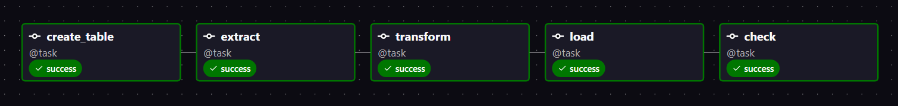
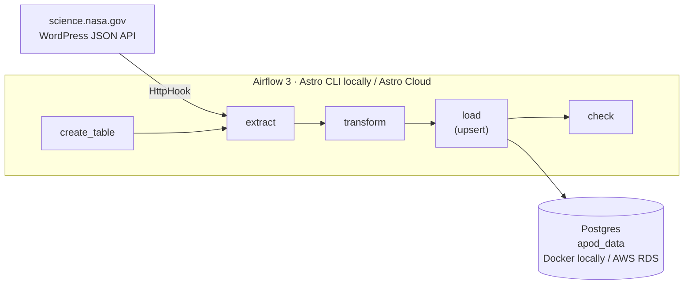
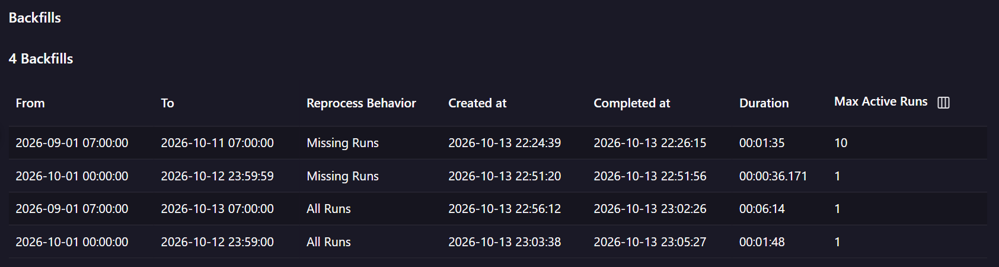
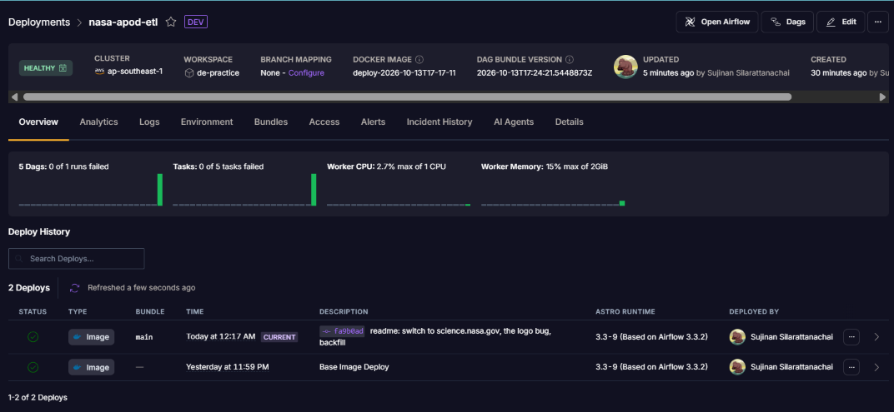
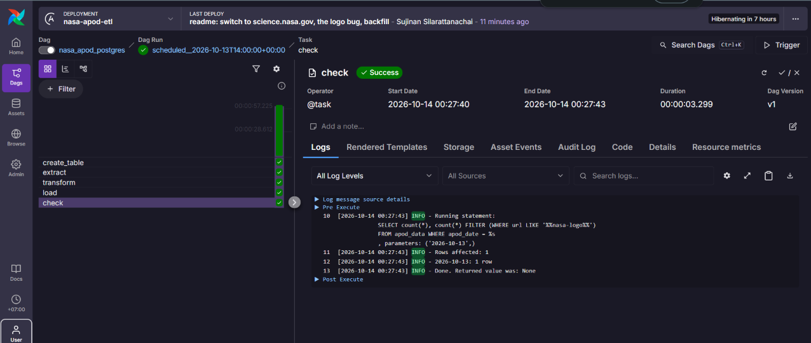

# NASA APOD Airflow ETL

Daily ETL pipeline on Apache Airflow 3: pulls NASA's [Astronomy Picture of the Day](https://science.nasa.gov/astronomy-picture-of-the-day/) for each run's own date, cleans it up and loads it into Postgres. Developed locally with the Astro CLI in Docker, deployed to Astro Cloud with Postgres on AWS RDS.

> **Status:** working end to end, locally and on Astro Cloud writing to AWS RDS. Backfilled for 2026-09-01 to 2026-10-13 (43 days).



## What it produces

One row per day in `apod_data`, with the title, explanation, image URL and source page. A few of the loaded days:

| 2026-10-13 | 2026-10-12 | 2026-10-10 | 2026-10-07 |
|---|---|---|---|
|  |  |  |  |
| Desert Stairway to Heaven | Jupiter and the Moons | Lunar Farside | Supernova Remnant Pa 30 |

Backfill result: **43 rows, 43 different pictures, 0 placeholder images.**

## Architecture



| Task | What it does |
|---|---|
| `create_table` | Creates `apod_data` if it does not exist, with the date as primary key |
| `extract` | Searches science.nasa.gov for the article titled `APOD: <year> <Month> <day>`, then fetches its featured image |
| `transform` | Strips the date prefix from the title, cuts the explanation out of the article HTML, fails hard if there is no real image |
| `load` | `INSERT ... ON CONFLICT (apod_date) DO UPDATE`, so re-running a date overwrites instead of duplicating |
| `check` | Confirms exactly one real row exists for the run's date |

Each run works on its own logical date (`{{ ds }}`), not "today", so any past date can be re-run or backfilled and get the right picture.

## What went wrong: green pipeline, wrong data

The first version called the official `api.nasa.gov/planetary/apod` endpoint. Every task was green, and after a backfill the table had 41 rows. Looking at the rows, all 41 had the same title ("NASA Science"), the same explanation and the NASA logo as the image. APOD has moved to science.nasa.gov and the old API now returns the new site's landing page for every date.

What changed because of it:

- **New source.** `extract` reads science.nasa.gov's WordPress JSON API instead: one search request for the day's article, one request for its image.
- **Data checks, not just status checks.** `transform` fails without retrying if the image is the logo or the title is missing, and `check` counts real rows for the date. A task succeeding only says the code ran, not that the data is right.
- **Reprocessing after a fix.** Deleting the bad rows and starting a backfill in the UI only filled one day, because the default "Missing Runs" mode skips dates that already have a successful run. Airflow tracks runs, not the rows in your table. The fix was a backfill that reruns completed dates on the latest DAG version:

```bash
astro dev run backfill create --dag-id nasa_apod_postgres \
  --from-date 2026-09-01 --to-date 2026-10-13 \
  --reprocess-behavior completed --run-on-latest-version --max-active-runs 1
```



## Running in the cloud

The same project is deployed to Astro Cloud with `astro deploy`, on AWS `ap-southeast-1`, next to a PostgreSQL instance on AWS RDS in the same region.



| | Local | Cloud |
|---|---|---|
| Airflow | Astro CLI in Docker | Astro Cloud, Development deployment (hibernates when idle) |
| Pipeline database | `apod-db` container | AWS RDS PostgreSQL, `db.t4g.micro` |
| Connections | `.env` | Deployment environment variables, the database one marked secret |
| Network access | Docker network | RDS security group allows only the deployment's egress IPs and my own IP |

The DAG code is identical in both places; only the `AIRFLOW_CONN_APOD_DB` value differs. First scheduled run on the cloud, writing to RDS:



## Design decisions

**A separate Postgres for the pipeline's data.** Airflow ships with its own Postgres for run history, task state and XCom. Pipeline data goes into a second database: the `apod-db` container locally (added through `docker-compose.override.yml`) and RDS in the cloud. Mixing the two would put business tables next to Airflow's internal ones, and `astro dev kill` would wipe both.

**Connections live in environment variables, not in the code.** The DAG only refers to connection names (`apod_db`, `nasa_science`). Host and password come from `AIRFLOW_CONN_*` variables: `.env` locally (git-ignored, and excluded from the Docker image by `.dockerignore`), the deployment's secret environment variables on Astro Cloud. Moving from Docker to RDS changed one variable and no code. `.env.example` shows the format.

**The date is the primary key.** NASA publishes one picture per day, so `apod_date` identifies a row. Loading the same date twice overwrites the row, which matters because Airflow retries failed tasks and backfills rerun dates.

**Scheduled at 14:00 UTC, not midnight.** APOD publishes on US Eastern time. At 00:00 UTC the current day's picture does not exist yet.

**Retries with a delay, but not for bad data.** Two retries, five minutes apart, for network errors or a picture that is not published yet. A wrong image raises `AirflowFailException`, which fails immediately, since retrying would get the same wrong answer.

**One run at a time.** `max_active_runs=1` keeps backfills from sending dozens of requests to NASA's site at once.

## Running it locally

Requires Docker Desktop and the [Astro CLI](https://www.astronomer.io/docs/astro/cli/install-cli).

```bash
cp .env.example .env
astro dev start
```

| Service | Address |
|---|---|
| Airflow UI | http://localhost:8080 |
| Pipeline database (`apod-db`) | `localhost:5434`, database `apod`, user `postgres` |

From inside Docker, Airflow reaches the pipeline database as `apod-db:5432`. The host port is 5434 because 5432 is Airflow's own Postgres and 5433 is commonly taken by a PostgreSQL install on Windows.

Stop with `astro dev stop`. `astro dev kill` deletes all data, including the pipeline database.

## Layout

```
dags/
  nasa_apod_postgres.py       the pipeline
  hello_pipeline.py           practice: task order with PythonOperator
  math_sequence.py            practice: passing values with XCom
  math_sequence_taskflow.py   practice: the same DAG with the TaskFlow API
tests/dags/                   import, tag and retry checks for every DAG
docker-compose.override.yml   the apod-db Postgres container
requirements.txt              HTTP and Postgres providers
.env.example                  connection format, no real secrets
docs/images/                  screenshots for this README
```

## Stack

Apache Airflow 3 (Task SDK, TaskFlow API) · Astro CLI · Astro Cloud · Docker · PostgreSQL · AWS RDS

## Progress

- [x] Local Airflow 3 with the Astro CLI
- [x] Practice DAGs: task order, XCom, TaskFlow
- [x] Separate Postgres container for pipeline data, connection in `.env`
- [x] `create_table` with the date as primary key
- [x] Extract by logical date (moved from api.nasa.gov to science.nasa.gov)
- [x] Transform and idempotent load (upsert)
- [x] Data check after load
- [x] Backfill 2026-09-01 to 2026-10-13
- [x] Postgres on AWS RDS (ap-southeast-1)
- [x] Deploy to Astro Cloud and run against RDS
