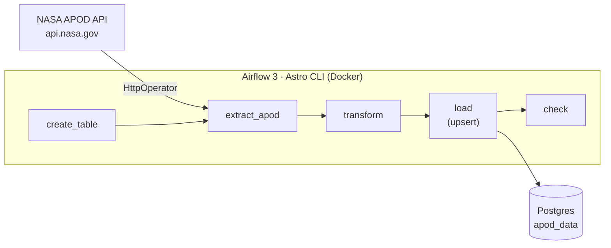

# NASA APOD Airflow ETL

Daily ETL pipeline on Apache Airflow 3: pulls NASA's [Astronomy Picture of the Day](https://api.nasa.gov/) for each run's own date, keeps the fields that matter, and loads them into Postgres. Runs locally with the Astro CLI in Docker.

> **Status: in progress.** The local stack and the table-creation step are working. Extract, transform and load are next; see [Progress](#progress).

## Architecture



One run per day. Each run asks the API for the picture of its own logical date, not "today", so any past date can be re-run or backfilled and get the right picture.

## Design decisions

**A separate Postgres for the pipeline's data.** Airflow ships with its own Postgres for run history, task state and XCom. Pipeline data goes into a second container, `apod-db`, added through `docker-compose.override.yml`. Mixing the two would put business tables next to Airflow's internal ones, and `astro dev kill` would wipe both.

**Connections live in `.env`, not in the code.** The DAG only refers to connection names (`apod_db`, `nasa_api`). Host, password and the API key come from `AIRFLOW_CONN_*` environment variables in `.env`, which is git-ignored. Moving to the cloud means changing those variables, not the DAG. `.env.example` shows the expected format.

**The date is the primary key.** NASA publishes one picture per day, so `apod_date` identifies a row. Loading the same date twice overwrites the row instead of adding a duplicate, which matters because Airflow retries failed tasks on its own.

**Scheduled at 14:00 UTC, not midnight.** APOD publishes on US Eastern time. At 00:00 UTC the current day's picture does not exist yet and the API returns 400.

**Retries with a delay.** Two retries, five minutes apart. An external API that fails once usually fails again if retried immediately.

## Running it locally

Requires Docker Desktop and the [Astro CLI](https://www.astronomer.io/docs/astro/cli/install-cli).

```bash
cp .env.example .env      # then fill in your own values
astro dev start
```

| Service | Address |
|---|---|
| Airflow UI | http://localhost:8080 |
| Pipeline database (`apod-db`) | `localhost:5434`, database `apod`, user `postgres` |

From inside Docker, Airflow reaches the pipeline database as `apod-db:5432`. The host port is 5434 because 5432 is Airflow's own Postgres and 5433 is commonly taken by a PostgreSQL install on Windows.

Stop with `astro dev stop`. `astro dev kill` deletes all data, including the pipeline database.

## Layout

```
dags/
  nasa_apod_postgres.py       the pipeline
  hello_pipeline.py           practice: task order with PythonOperator
  math_sequence.py            practice: passing values with XCom
  math_sequence_taskflow.py   practice: the same DAG with the TaskFlow API
tests/dags/                   import, tag and retry checks for every DAG
docker-compose.override.yml   the apod-db Postgres container
requirements.txt              HTTP and Postgres providers
.env.example                  connection format, no real secrets
```

## Stack

Apache Airflow 3 (Task SDK, TaskFlow API) · Astro CLI · Docker · PostgreSQL 16 · NASA APOD API

## Progress

- [x] Local Airflow 3 with the Astro CLI
- [x] Practice DAGs: task order, XCom, TaskFlow
- [x] Separate Postgres container for pipeline data, connection in `.env`
- [x] `create_table` with the date as primary key
- [ ] Extract from the NASA API by logical date
- [ ] Transform and idempotent load (upsert)
- [ ] Row check after load
- [ ] Backfill and tests
- [ ] Deploy to Astro Cloud with Postgres on AWS RDS
